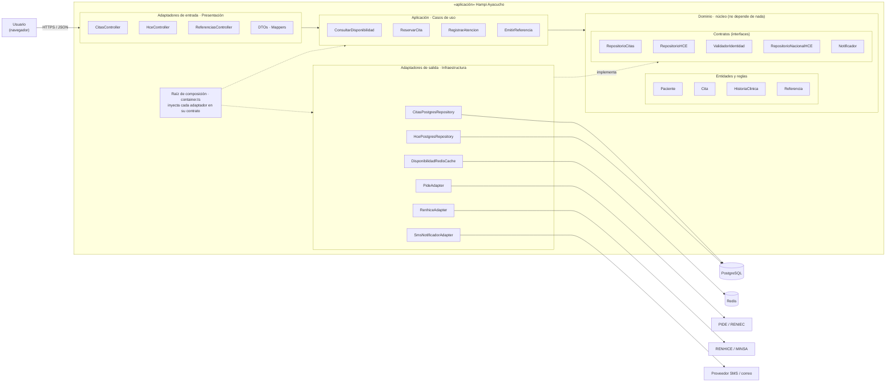

# Enfoque Arquitectónico - Clean Architecture - Hampi Ayacucho

## 1. Descripción del enfoque

| Elemento | Descripción aplicada a Hampi Ayacucho |
| :--- | :--- |
| **Patrón / enfoque arquitectónico** | Clean Architecture (Arquitectura Limpia). |
| **Objetivo** | Separar responsabilidades y controlar que las dependencias apunten hacia el dominio sanitario. |
| **¿Qué problema resuelve?** | Evita el acoplamiento entre la interfaz web, las reglas de atención en salud y las tecnologías externas como la base de datos, PIDE, RENHICE y el servicio de mensajería. |
| **Capas definidas** | Dominio, Aplicación, Adaptadores (Presentación e Infraestructura) y Frameworks & Drivers. |
| **Beneficios** | • Facilita el mantenimiento y las pruebas unitarias del dominio sin base de datos.<br>• Permite cambiar implementaciones técnicas (por ejemplo, una nueva versión de RENHICE) sin modificar las reglas sanitarias.<br>• Mejora la organización y separación de responsabilidades del código. |

## 2. Partes de Clean Architecture aplicadas

| Parte | ¿Qué contiene? | Ejemplo en Hampi Ayacucho |
| :--- | :--- | :--- |
| **Entities (Dominio)** | Reglas de negocio fundamentales. | `Paciente`, `Cita`, `HistoriaClinica`, `Referencia`, `Establecimiento`. |
| **Use Cases (Aplicación)** | Reglas específicas de la aplicación; orquestan el dominio. | `ConsultarDisponibilidad`, `ReservarCita`, `RegistrarAtencion`, `EmitirReferencia`, `GenerarReporteMINSA`. |
| **Interface Adapters** | Adaptan datos entre el núcleo y el exterior. | Controllers REST, DTOs, mappers, repositorios PostgreSQL, adaptadores PIDE/RENHICE. |
| **Frameworks & Drivers** | Detalles tecnológicos externos. | Angular, Node.js + Express, PostgreSQL, Redis, APIs PIDE y RENHICE, proveedor SMS. |

## 3. Reglas de negocio del dominio (ejemplos)
- Una cita solo puede reservarse si existe un cupo disponible en el horario y la especialidad.
- Un paciente no puede tener dos citas en la misma especialidad el mismo día.
- Una cita cancelada no puede volver a confirmarse.
- Una referencia debe incluir diagnóstico presuntivo y el establecimiento de destino debe ser de mayor nivel resolutivo.
- Solo el personal de salud autorizado puede registrar o consultar la historia clínica; cada acceso queda auditado.

## 4. Diagrama de Clean Architecture



**Leyenda:** flecha continua = dependencia de código (siempre hacia el centro); flecha punteada = implementa un contrato del dominio o lo inyecta (inversión de dependencias).

## 5. Regla de dependencia
1. El **dominio** no importa nada de las capas externas: ni Express, ni el ORM, ni Redis.
2. Los **casos de uso** solo conocen entidades y contratos del dominio.
3. Los **adaptadores** implementan los contratos y son intercambiables (por ejemplo, `PideAdapter` real o `PideSimulado` para pruebas).
4. Cambiar de tecnología = cambiar la raíz de composición, **no el dominio**.

## 6. Ejemplo de flujo: reservar una cita (HU02 / RF02, RF03)
1. `CitasController` recibe `POST /api/v1/citas` y convierte el JSON en un DTO.
2. Llama al caso de uso `ReservarCita`.
3. `ReservarCita` usa `ValidadorIdentidad` para validar el DNI (implementado por `PideAdapter`).
4. Crea la entidad `Cita`, que valida las reglas (cupo disponible, sin duplicados).
5. Guarda mediante `RepositorioCitas` (implementado por `CitasPostgresRepository`) e invalida la caché de cupos.
6. Envía la confirmación con el QR usando `Notificador` (implementado por `SmsNotificadorAdapter`).

El caso de uso nunca sabe que existen PostgreSQL, PIDE o el proveedor de SMS: solo conoce los contratos.

## 7. Estructura de carpetas propuesta (por módulo)

```text
hampi-ayacucho/
└── src/
    ├── modules/
    │   ├── citas/
    │   │   ├── domain/
    │   │   │   ├── entities/          # Cita.ts, Cupo.ts
    │   │   │   ├── value-objects/     # Dni.ts, CodigoQR.ts
    │   │   │   └── ports/             # RepositorioCitas.ts, Notificador.ts
    │   │   ├── application/
    │   │   │   └── use-cases/         # ConsultarDisponibilidad.ts, ReservarCita.ts, CancelarCita.ts
    │   │   ├── adapters/
    │   │   │   ├── controllers/       # CitasController.ts
    │   │   │   └── dto/               # ReservarCitaDTO.ts
    │   │   └── infrastructure/
    │   │       ├── repositories/      # CitasPostgresRepository.ts
    │   │       ├── cache/             # DisponibilidadRedisCache.ts
    │   │       └── gateways/          # SmsNotificadorAdapter.ts
    │   ├── usuarios/                  # misma estructura · PideAdapter
    │   ├── hce/                       # misma estructura · RenhiceAdapter
    │   ├── referencias/
    │   └── reportes/
    ├── shared/                        # middlewares, auth JWT + 2FA, auditoría, logger
    ├── config/
    │   └── container.ts               # raíz de composición (inyección de dependencias)
    └── server.ts                      # arranque de Express
```

## 8. Relación con el estilo arquitectónico
- El **estilo** (monolito modular en capas) define cómo se organiza y despliega el sistema **globalmente**.
- El **enfoque** (Clean Architecture) define cómo se organizan las responsabilidades y dependencias **dentro de cada módulo**.
- Ambos responden al driver **DA06 - Mantenibilidad** y se documentan en ADR-001 y ADR-002.
