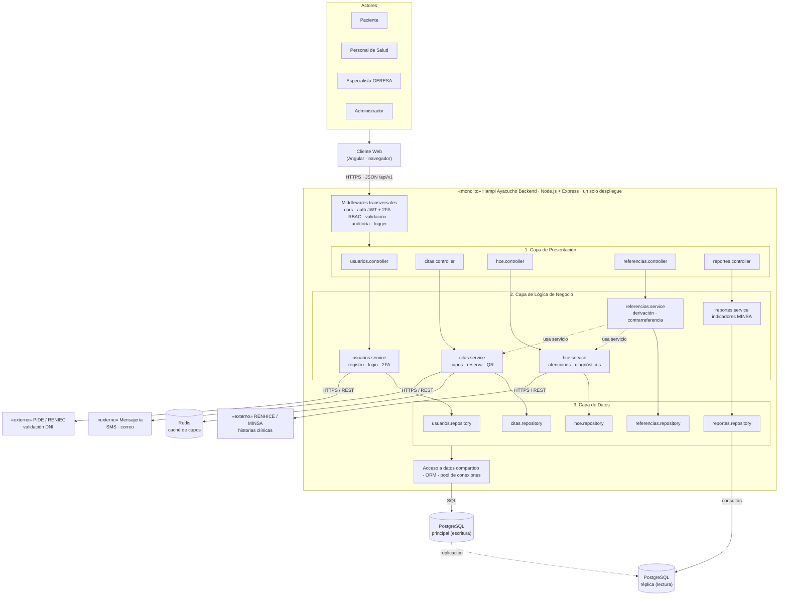

# Estilo Arquitectónico - Hampi Ayacucho

## 1. Estilo seleccionado
**Monolito modular + arquitectura en capas.**

- **Monolito:** el backend es **una sola aplicación** que se ejecuta en un solo proceso y se despliega como una unidad (unidad de despliegue).
- **Modular:** internamente se divide en **módulos por dominio** (Usuarios, Citas, HCE, Referencias y Reportes) con límites claros.
- **En capas:** cada módulo se organiza en **Presentación → Lógica de negocio → Datos** (organización lógica).

> Capas = organización lógica. Monolito = unidad de despliegue. Ambos conceptos coexisten.

## 2. Estilos evaluados

| Estilo | ¿Por qué sí / por qué no? | Decisión |
| :--- | :--- | :--- |
| Monolito tradicional | Simple, pero mezcla responsabilidades y dificulta incorporar cambios normativos (DA06). | Descartado |
| **Monolito modular en capas** | Simple de desplegar y operar para la GERESA, con módulos separados que pueden escalar horizontalmente (DA01) y evolucionar (DA06). | **Seleccionado** |
| Microservicios | Escala por servicio, pero exige equipos, infraestructura y monitoreo que la GERESA aún no tiene. | Descartado (posible evolución futura) |
| Event-Driven | Útil para notificaciones, pero agrega complejidad innecesaria para el núcleo del sistema. | Descartado como estilo global |

## 3. Justificación con los drivers

| Driver | Cómo lo responde el estilo |
| :--- | :--- |
| DA01 - Escalabilidad | El monolito es sin estado: se ejecutan varias instancias detrás de un balanceador; la caché Redis se comparte. |
| DA03 - API REST | El cliente web se separa del backend y se comunica solo por HTTPS/JSON. |
| DA04 - Integración externa | Los servicios externos se invocan solo desde la capa de negocio mediante adaptadores. |
| DA05 - Disponibilidad | Varias instancias + réplica de lectura de la base de datos. |
| DA06 - Mantenibilidad | Cada módulo se modifica sin afectar a los demás; se comunican solo a través de su servicio. |

## 4. Diagrama de arquitectura

## 5. Reglas de la arquitectura
1. Cada capa solo invoca a la capa inmediatamente inferior (Controller → Service → Repository).
2. Un módulo **no** accede al repository ni a las tablas de otro módulo; se comunica llamando a su **service**.
3. Los sistemas externos solo se invocan desde la capa de lógica de negocio.
4. Todo se ejecuta en un único proceso Node.js; la escalabilidad se logra con varias instancias idénticas detrás de un balanceador.
5. Los reportes de la GERESA leen de la réplica para no bloquear el registro de citas.
