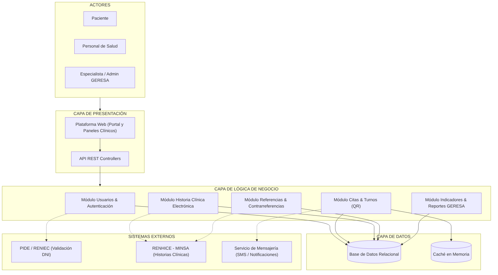

# Arquitectura Inicial del Sistema - Hampi Ayacucho

## 1. Organización en Tres Capas
- **Capa de Presentación:** Plataforma web unificada (Portal Pacientes y Paneles Clínicos/GERESA) comunicándose con los controladores de una API REST.
- **Capa de Lógica de Negocio:** Procesa las reglas mediante módulos de Usuarios (2FA), Citas y Turnos (QR), Historia Clínica Electrónica, Referencias y Reportes.
- **Capa de Datos:** Persistencia relacional junto con una capa de aceleración con caché en memoria.
- **Sistemas Externos:** Integración con RENHICE (MINSA), PIDE (RENIEC) y servicios de mensajería (SMS/Email).

---

## 2. Diagrama de Arquitectura

> Fuente editable: `img/fuentes/arquitectura-inicial.mmd` (Mermaid)

## Descripción de la Arquitectura
La arquitectura inicial de **Hampi Ayacucho** se organiza en tres capas principales:

- **Presentación:** canaliza toda la interacción mediante la plataforma web unificada (portal ciudadano y paneles clínicos para el personal de salud) comunicándose a través de una API REST.
- **Lógica de Negocio:** concentra los módulos de procesamiento del dominio sanitario: Usuarios & Autenticación, Citas & Turnos (fichas digitales QR), Historia Clínica Electrónica (HCE), Referencias & Contrarreferencias e Indicadores para GERESA.
- **Datos:** garantiza la persistencia relacional íntegra de registros médicos mediante la base de datos principal, complementada con una capa de caché en memoria para optimizar la consulta de disponibilidad de citas.

Además, los módulos de la capa de negocio se integran de forma desacoplada con sistemas externos: la **PIDE (RENIEC)** para la verificación de identidad ciudadana, el **RENHICE (MINSA)** para la interoperabilidad de historias clínicas y el **servicio de mensajería** para notificaciones automáticas vía SMS y correo.