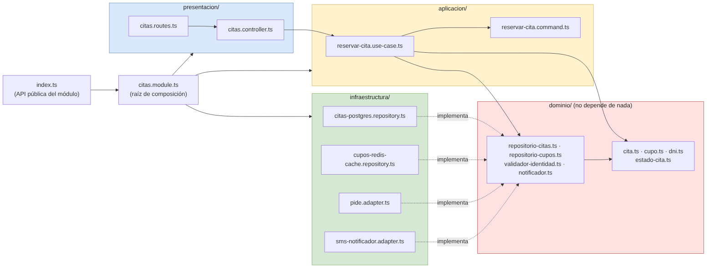

# Diseño interno de módulos

> **Proyecto:** Hampi Ayacucho · **Backend:** Node.js + TypeScript · **Módulo de referencia:** Citas  
> **Enfoque arquitectónico:** Clean Architecture dentro de cada módulo del monolito modular  
> **Nivel C4:** 4 – Código · **Versión:** 1.0

---

## 1. Propósito

Este documento describe **cómo se organiza el código dentro de un módulo** del backend. Tiene tres objetivos:

- que todos los módulos (Usuarios, Citas, HCE, Referencias, Reportes, Notificaciones, Auditoría) se construyan con la misma estructura;
- que las reglas sanitarias queden aisladas de la tecnología;
- que cualquier integrante del equipo sepa dónde va cada archivo y de qué puede depender.

Se toma **Citas** como módulo de referencia porque soporta la mayor carga (EQ-01) y se integra con la base de datos, la caché, la PIDE y el servicio de mensajería. El código está en `tecnologia/boilerplate-clean-arquitecture/`.

---

## 2. Estructura de carpetas

```text
src/
└── modules/
    └── citas/
        ├── dominio/
        │   ├── cita.ts                        Entidad Cita y sus reglas (RN-01 a RN-04)
        │   ├── cupo.ts                        Entidad Cupo (ocupar / liberar)
        │   ├── dni.ts                         Objeto de valor Dni
        │   ├── estado-cita.ts                 Enumeración EstadoCita
        │   ├── repositorio-citas.ts           Puerto de persistencia de citas
        │   ├── repositorio-cupos.ts           Puerto de persistencia de cupos
        │   ├── validador-identidad.ts         Puerto hacia la PIDE / RENIEC
        │   └── notificador.ts                 Puerto hacia el servicio de mensajería
        ├── aplicacion/
        │   ├── reservar-cita.use-case.ts      Caso de uso ReservarCita
        │   └── reservar-cita.command.ts       Datos de entrada y salida del caso de uso
        ├── infraestructura/
        │   ├── citas-postgres.repository.ts   Implementación con PostgreSQL
        │   ├── cupos-redis-cache.repository.ts Decorator con Redis
        │   ├── pide.adapter.ts                Implementación con la PIDE
        │   └── sms-notificador.adapter.ts     Implementación con el proveedor de SMS
        ├── presentacion/
        │   ├── citas.controller.ts            Traduce HTTP ⇄ caso de uso
        │   └── citas.routes.ts                Rutas /api/v1/citas
        ├── citas.module.ts                    Raíz de composición del módulo
        └── index.ts                           API pública del módulo
```

| Archivo | Capa | Responsabilidad | Importa de |
| :--- | :--- | :--- | :--- |
| `cita.ts` | Dominio | Reservar, cancelar y confirmar asistencia respetando las reglas | Solo dominio |
| `cupo.ts` | Dominio | Controlar si un horario está disponible | Nada |
| `dni.ts` | Dominio | Garantizar un DNI de 8 dígitos | Nada |
| `estado-cita.ts` | Dominio | Definir los estados posibles de la cita | Nada |
| `repositorio-citas.ts` | Dominio | Declarar **qué** operaciones de persistencia necesita el módulo | `cita.ts`, `cupo.ts`, `dni.ts` |
| `validador-identidad.ts` | Dominio | Declarar **qué** se necesita para validar la identidad | `dni.ts` |
| `notificador.ts` | Dominio | Declarar **qué** se necesita para avisar al paciente | `cita.ts` |
| `reservar-cita.use-case.ts` | Aplicación | Coordinar los pasos de la reserva | Dominio |
| `reservar-cita.command.ts` | Aplicación | Datos de entrada y salida del caso de uso | Nada |
| `citas-postgres.repository.ts` | Infraestructura | Guardar y leer citas en PostgreSQL | Dominio + driver de BD |
| `cupos-redis-cache.repository.ts` | Infraestructura | Leer cupos primero desde Redis | Dominio + cliente Redis |
| `pide.adapter.ts` | Infraestructura | Traducir `validar()` al servicio de RENIEC en la PIDE | Dominio + cliente HTTP |
| `sms-notificador.adapter.ts` | Infraestructura | Traducir `citaReservada()` a la API del proveedor de SMS | Dominio + cliente HTTP |
| `citas.controller.ts` | Presentación | Leer la petición HTTP, invocar el caso de uso y responder | Aplicación |
| `citas.routes.ts` | Presentación | Registrar las rutas en Express | Presentación |
| `citas.module.ts` | Composición | Crear las instancias concretas e inyectarlas | Todas las capas |
| `index.ts` | Composición | Exponer solo lo que otros módulos pueden usar | `citas.module.ts` |

---

## 3. Capas del módulo y regla de dependencia



> Fuente editable: `img/fuentes/paquetes-modulo-citas.mmd`

**Regla de dependencia:** el código solo puede importar hacia el centro (dominio). El dominio no conoce Express, PostgreSQL, Redis ni la PIDE.

| Capa | Contiene | Responsabilidad | Puede depender de | **No** puede depender de |
| :--- | :--- | :--- | :--- | :--- |
| **Dominio** | Entidades, objetos de valor, enumeraciones, puertos | Reglas sanitarias que serían ciertas con cualquier tecnología | Nada externo | Aplicación, infraestructura, presentación, Express, ORM, SDK |
| **Aplicación** | Casos de uso, comandos | Orquestar el flujo: qué paso va primero y qué hacer si falla | Dominio | Infraestructura, presentación, Express, ORM |
| **Infraestructura** | Repositorios y adaptadores | Implementar los puertos con una tecnología | Dominio, librerías externas | Aplicación, presentación |
| **Presentación** | Controladores, rutas | Traducir HTTP a llamadas del caso de uso y viceversa | Aplicación | Infraestructura, base de datos |
| **Composición** | `citas.module.ts` | Elegir implementaciones concretas y conectarlas | Todas | — |

> **Cómo comprobarlo en el código:** revisar los `import` de `dominio/`. Si aparece `express`, `pg`, `redis` o cualquier archivo de `infraestructura/`, la regla se rompió (verificación del escenario EQ-06).

---

## 4. Reglas de negocio del módulo

| Código | Regla | Dónde se aplica |
| :--- | :--- | :--- |
| RN-00 | El DNI debe tener 8 dígitos | `Dni` |
| RN-01 | Solo se puede reservar un cupo disponible | `Cupo.ocupar()` |
| RN-02 | Un paciente no puede tener dos citas en la misma especialidad el mismo día | `Cita.reservar()` |
| RN-03 | Una cita atendida no puede cancelarse; al cancelar se libera el cupo | `Cita.cancelar()` |
| RN-04 | Solo una cita reservada puede marcarse como atendida | `Cita.confirmarAsistencia()` |

---

## 5. Diagrama de clases


La notación UML se explica en `docs/04-modelo-c4/Nivel4-DiagramadeCodigo.md`.

---

## 6. Flujo de ejecución: reservar cita


| Paso | Origen → destino | Acción | Capa |
| :--- | :--- | :--- | :--- |
| 1 | Aplicación web → `CitasController` | `POST /api/v1/citas` con `dni` y `cupoId` | Presentación |
| 2 | `CitasController` → `ReservarCitaUseCase` | `ejecutar(cmd)` | Presentación → Aplicación |
| 3–6 | `ReservarCitaUseCase` → `ValidadorIdentidad` | `validar(dni)` contra RENIEC | Aplicación → Dominio (puerto) → Infraestructura |
| 7–8 | `ReservarCitaUseCase` → `RepositorioCupos` | `buscarPorId(cupoId)` (Redis primero) | Aplicación → Dominio (puerto) |
| 9–10 | `ReservarCitaUseCase` → `RepositorioCitas` | `existeEnEspecialidadYDia(dni, cupo)` | Aplicación → Dominio (puerto) |
| 11 | `ReservarCitaUseCase` → `Cita` | `reservar(...)`: RN-01, RN-02, estado RESERVADA, código QR | Aplicación → Dominio |
| 12–13 | `ReservarCitaUseCase` → repositorios | Guarda la cita y el cupo ocupado; invalida la caché | Aplicación → Infraestructura |
| 14 | `ReservarCitaUseCase` → `Notificador` | `citaReservada(cita)` | Aplicación → Infraestructura |
| 15–16 | `CitasController` → Aplicación web | `201 Created` con la ficha QR | Presentación |
| 17–18 | Alternativa | Regla incumplida: `409 Conflict` con el motivo | Aplicación → Presentación |

---

## 7. Código de referencia

### 7.1 Dominio · entidad y puerto

```ts
// dominio/cita.ts (extracto)
export class Cita {
  static reservar(dni: Dni, cupo: Cupo, yaTieneCitaEseDia: boolean): Cita {
    if (yaTieneCitaEseDia) {
      throw new ReglaNegocioError('RN-02: el paciente ya tiene una cita en esa especialidad ese día');
    }
    cupo.ocupar(); // valida RN-01
    const id = randomUUID();
    return new Cita(id, dni, cupo, EstadoCita.RESERVADA, `HAMPI-${id.slice(0, 8).toUpperCase()}`);
  }

  cancelar(): void {                       // RN-03
    if (this.estado === EstadoCita.ATENDIDA) {
      throw new ReglaNegocioError('RN-03: una cita atendida no puede cancelarse');
    }
    this.estado = EstadoCita.CANCELADA;
    this.cupo.liberar();
  }
}
```

```ts
// dominio/validador-identidad.ts
export interface ValidadorIdentidad {
  validar(dni: Dni): Promise<boolean>;
}
```

### 7.2 Aplicación · caso de uso

```ts
// aplicacion/reservar-cita.use-case.ts
export class ReservarCitaUseCase {
  constructor(
    private readonly citas: RepositorioCitas,          // interfaz, no PostgreSQL
    private readonly cupos: RepositorioCupos,          // interfaz, no Redis
    private readonly identidad: ValidadorIdentidad,    // interfaz, no PIDE
    private readonly notificador: Notificador,         // interfaz, no proveedor SMS
  ) {}

  async ejecutar(cmd: ReservarCitaCommand): Promise<CitaReservada> {
    const dni = new Dni(cmd.dni);
    if (!(await this.identidad.validar(dni))) {
      throw new ReglaNegocioError('El DNI no fue validado por RENIEC');
    }
    const cupo = await this.cupos.buscarPorId(cmd.cupoId);
    if (!cupo) throw new ReglaNegocioError('El cupo solicitado no existe');

    const duplicada = await this.citas.existeEnEspecialidadYDia(dni, cupo);
    const cita = Cita.reservar(dni, cupo, duplicada);

    await this.citas.guardar(cita);
    await this.cupos.guardar(cupo);
    await this.notificador.citaReservada(cita);
    return { citaId: cita.id, codigoQR: cita.codigoQR, /* ... */ };
  }
}
```

### 7.3 Infraestructura · decorator de caché

```ts
// infraestructura/cupos-cache.repository.ts
export class CuposCacheRepository implements RepositorioCupos {
  private readonly cache = new Map<string, Cupo>();   // en producción: Redis

  constructor(private readonly origen: RepositorioCupos) {}

  async buscarPorId(id: string): Promise<Cupo | null> {
    const enCache = this.cache.get(id);
    if (enCache) return enCache;
    const cupo = await this.origen.buscarPorId(id);
    if (cupo) this.cache.set(id, cupo);
    return cupo;
  }

  async guardar(cupo: Cupo): Promise<void> {
    await this.origen.guardar(cupo);
    this.cache.delete(cupo.id);   // invalida para no mostrar cupos ocupados
  }
}
```

### 7.4 Presentación · controlador

```ts
// presentacion/citas.controller.ts
export class CitasController {
  constructor(private readonly reservarCita: ReservarCitaUseCase) {}

  async reservar(cuerpo: { dni?: string; cupoId?: string }): Promise<RespuestaHttp> {
    if (!cuerpo.dni || !cuerpo.cupoId) {
      return { estado: 400, cuerpo: { error: 'dni y cupoId son obligatorios' } };
    }
    try {
      const resultado = await this.reservarCita.ejecutar({ dni: cuerpo.dni, cupoId: cuerpo.cupoId });
      return { estado: 201, cuerpo: resultado };
    } catch (e) {
      if (e instanceof ReglaNegocioError) return { estado: 409, cuerpo: { error: e.message } };
      throw e;
    }
  }
}
```

### 7.5 Raíz de composición

```ts
// citas.module.ts
export function crearModuloCitas(cuposIniciales: Cupo[], dnisRenieC: string[]) {
  const cuposBd = new CuposMemoriaRepository(new Map(cuposIniciales.map((c) => [c.id, c])));
  const cupos = new CuposCacheRepository(cuposBd);            // Decorator
  const citas = new CitasMemoriaRepository();                 // → CitasPostgresRepository
  const identidad = new PideSimuladoAdapter(dnisRenieC);      // → PideAdapter
  const notificador = new NotificadorConsolaAdapter();        // → SmsNotificadorAdapter

  const reservarCita = new ReservarCitaUseCase(citas, cupos, identidad, notificador);
  return { controller: new CitasController(reservarCita), notificador, cuposBd };
}
```

> Pasar de las implementaciones simuladas a PostgreSQL, Redis, PIDE y SMS solo cambia este archivo.

---

## 8. Pruebas

El ejemplo incluye 8 pruebas (`npm test`) que verifican las reglas RN-00 a RN-04, el caso de uso completo (201, DNI no validado, reserva duplicada) y el funcionamiento de la caché. Las pruebas del dominio **no necesitan base de datos, HTTP ni PIDE**, lo que demuestra el beneficio de Clean Architecture.
