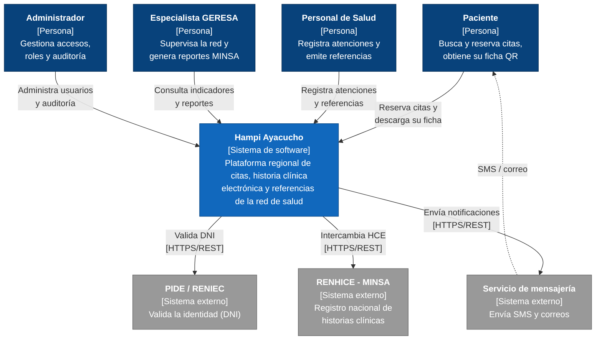

# Nivel 1 · Diagrama de contexto del sistema

> **Proyecto:** Hampi Ayacucho  
> **Modelo:** C4 · Nivel 1 de 4 · **Versión:** 1.0

---

## 1. Objetivo

Mostrar **Hampi Ayacucho como una sola caja**: quiénes lo usan y con qué sistemas externos se comunica. Es la vista de mayor nivel y la primera que se presenta a cualquier persona, técnica o no (por ejemplo, a la GERESA).

| Aspecto | Descripción |
| :--- | :--- |
| Pregunta que responde | ¿Qué es el sistema, quién lo usa y con quién se integra? |
| Audiencia | Todos: GERESA, docentes, personal de salud, equipo de desarrollo, operaciones |
| Qué **no** muestra | Tecnologías, servidores, bases de datos ni módulos internos |
| Siguiente nivel | `Nivel2-DiagramadeContenedores.md` |

---

## 2. Diagrama

> Fuente editable: `img/fuentes/nivel1-contexto.mmd`

---

## 3. Personas (usuarios)

| Persona | Descripción | Qué hace en el sistema | Origen |
| :--- | :--- | :--- | :--- |
| **Paciente** | Ciudadano que se atiende en la red de salud de Ayacucho | Consulta cupos, reserva citas, descarga su ficha QR y recibe notificaciones | HU01, HU02 |
| **Personal de Salud** | Médicos y administrativos de hospitales, centros y puestos de salud | Registra atenciones en la HCE, emite y recibe referencias | HU03, HU04, HU05 |
| **Especialista GERESA** | Responsable de supervisar la red asistencial | Revisa el dashboard de ocupación y genera reportes para el MINSA | HU06, HU07 |
| **Administrador** | Responsable de la operación y seguridad | Gestiona usuarios, roles, 2FA y revisa la auditoría | HU08 |

---

## 4. Sistemas

| Sistema | Tipo | Responsabilidad | Quién lo construye |
| :--- | :--- | :--- | :--- |
| **Hampi Ayacucho** | Sistema en alcance | Gestiona citas, historia clínica electrónica y referencias de la red de salud regional | El equipo del proyecto |
| **PIDE / RENIEC** | Sistema externo | Valida la identidad de los ciudadanos (DNI) | Gobierno peruano (PCM / RENIEC) |
| **RENHICE - MINSA** | Sistema externo | Registro nacional de historias clínicas electrónicas | Ministerio de Salud |
| **Servicio de mensajería** | Sistema externo | Envía SMS y correos electrónicos | Proveedor de mensajería |

---

## 5. Relaciones

| Origen | Destino | Descripción | Protocolo |
| :--- | :--- | :--- | :--- |
| Paciente | Hampi Ayacucho | Reserva citas y descarga su ficha | — |
| Personal de Salud | Hampi Ayacucho | Registra atenciones y referencias | — |
| Especialista GERESA | Hampi Ayacucho | Consulta indicadores y reportes | — |
| Administrador | Hampi Ayacucho | Administra usuarios y auditoría | — |
| Hampi Ayacucho | PIDE / RENIEC | Valida el DNI | HTTPS/REST |
| Hampi Ayacucho | RENHICE - MINSA | Intercambia historias clínicas | HTTPS/REST |
| Hampi Ayacucho | Servicio de mensajería | Envía notificaciones | HTTPS/REST |
| Servicio de mensajería | Paciente | Entrega el SMS o correo | SMS / correo |

> En el nivel 1 no se indica el protocolo entre personas y sistema: eso se detalla en el nivel 2.

---

## 6. Decisiones y supuestos

| # | Decisión o supuesto | Motivo |
| :--- | :--- | :--- |
| 1 | Los tres sistemas externos se integran mediante sus API REST | Es el mecanismo que ofrecen y no requiere acceso a sus bases de datos (RC04, RC05) |
| 2 | Hampi **no reemplaza** al RENHICE, se sincroniza con él | El MINSA es el responsable del registro nacional |
| 3 | Los sistemas externos no se modifican | Son de terceros; Hampi se adapta a ellos (patrón Adapter, ADR-006) |
| 4 | Un único sistema web para todos los actores | Restricción RC01: plataforma exclusivamente web |

### Pendientes por definir

| Tema | Detalle |
| :--- | :--- |
| Acceso a la PIDE | Confirmar con la GERESA el convenio y las credenciales para consumir el servicio de RENIEC |
| Formato del RENHICE | Validar la versión vigente de la norma técnica de intercambio del MINSA |
| Proveedor de mensajería | Definir si se usará un proveedor de SMS comercial o un servicio del Estado |
