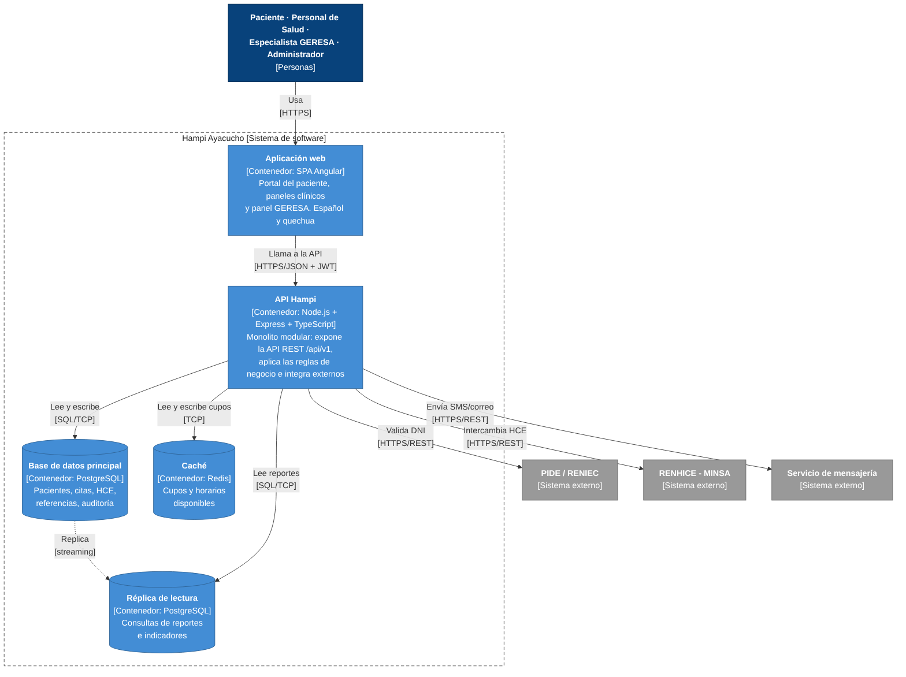

# Nivel 2 · Diagrama de contenedores

> **Proyecto:** Hampi Ayacucho  
> **Modelo:** C4 · Nivel 2 de 4 · **Versión:** 1.0

---

## 1. Objetivo

Abrir la caja «Hampi Ayacucho» del nivel 1 y mostrar los **contenedores** que la forman: las aplicaciones y almacenes de datos que se ejecutan por separado, la tecnología de cada uno y cómo se comunican.

| Aspecto | Descripción |
| :--- | :--- |
| Pregunta que responde | ¿De qué piezas ejecutables se compone el sistema y con qué tecnología? |
| Audiencia | Arquitectos, desarrolladores, operaciones |
| Qué es un contenedor | Algo que se ejecuta o almacena datos de forma independiente: una aplicación web, una API, una base de datos (no es lo mismo que un contenedor Docker) |
| Nivel anterior | `Nivel1-DiagramadeContextodelSistema.md` |
| Siguiente nivel | `Nivel3-Diagrama-de-Componentes.md` |

---

## 2. Diagrama

> Fuente editable: `img/fuentes/nivel2-contenedores.mmd`

---

## 3. Contenedores

| Contenedor | Tecnología | Responsabilidad | Datos que maneja |
| :--- | :--- | :--- | :--- |
| **Aplicación web** | SPA · Angular | Portal del paciente, paneles clínicos y panel GERESA, en español y quechua. Se ejecuta en el navegador | Ninguno persistente; solo el estado de la pantalla |
| **API Hampi** | Node.js + Express + TypeScript | Expone la API REST, aplica las reglas de negocio e integra los sistemas externos. Es un **monolito modular**: un solo proceso con módulos internos | Ninguno propio; usa la base de datos y la caché |
| **Base de datos principal** | PostgreSQL | Almacena de forma permanente y transaccional la información | Usuarios, pacientes, cupos, citas, HCE, referencias, auditoría |
| **Réplica de lectura** | PostgreSQL (réplica) | Atiende las consultas pesadas de reportes sin afectar el registro de citas | Copia de solo lectura de la base principal |
| **Caché** | Redis | Guarda en memoria los cupos y horarios más consultados | Copia temporal de la disponibilidad |

---

## 4. Relaciones

| Origen | Destino | Descripción | Protocolo |
| :--- | :--- | :--- | :--- |
| Paciente, Personal de Salud, Especialista GERESA, Administrador | Aplicación web | Usan la aplicación desde el navegador | HTTPS |
| Aplicación web | API Hampi | Llama a la API | HTTPS/JSON + JWT |
| API Hampi | Base de datos principal | Lee y escribe información | SQL sobre TCP |
| Base de datos principal | Réplica de lectura | Replica los cambios | Replicación por streaming |
| API Hampi | Réplica de lectura | Consulta reportes e indicadores | SQL sobre TCP |
| API Hampi | Caché | Lee y escribe cupos disponibles | TCP |
| API Hampi | PIDE / RENIEC | Valida el DNI | HTTPS/REST |
| API Hampi | RENHICE - MINSA | Intercambia historias clínicas | HTTPS/REST |
| API Hampi | Servicio de mensajería | Envía SMS y correos | HTTPS/REST |

---

## 5. Decisiones arquitectónicas reflejadas

| Decisión | Alternativa descartada | Motivo | ADR |
| :--- | :--- | :--- | :--- |
| Un único contenedor de backend (monolito modular) | Microservicios | Equipo técnico reducido en la GERESA; los módulos permiten separar servicios en el futuro | ADR-001 |
| Frontend separado del backend (SPA + API REST) | Páginas generadas en el servidor | Restricción RC03; frontend y backend evolucionan por separado | ADR-003 |
| PostgreSQL como base de datos | Base de datos NoSQL | Citas, HCE y referencias necesitan transacciones y consistencia | — |
| Redis como caché de cupos | Consultar siempre la base de datos | La disponibilidad es lo más consultado en la apertura de cupos (EQ-01) | ADR-004 |
| Réplica de lectura para reportes | Una sola base de datos | Los reportes no deben bloquear el registro de citas (EQ-02) | ADR-007 |
| Solo la API se comunica con los sistemas externos | Llamar a PIDE desde el navegador | Las credenciales del Estado quedan en el servidor | ADR-006 |

---

## 6. Seguridad entre contenedores

| Comunicación | Medida |
| :--- | :--- |
| Navegador → Aplicación web y API | Tráfico cifrado con HTTPS |
| Aplicación web → API | Token JWT con segundo factor (2FA) y control de roles (RBAC) en cada petición |
| API → Base de datos y caché | Acceso solo desde la red interna; credenciales en variables de entorno; datos sensibles cifrados (AES-256) |
| API → Sistemas externos | Credenciales de PIDE, RENHICE y mensajería guardadas solo en el servidor |

---

## 7. Despliegue previsto

La API Hampi es **sin estado**, por lo que se ejecutan **al menos dos instancias** detrás de un balanceador de carga. Así se atiende el escalamiento horizontal (EQ-03) y la disponibilidad ante la caída de una instancia (EQ-02).
