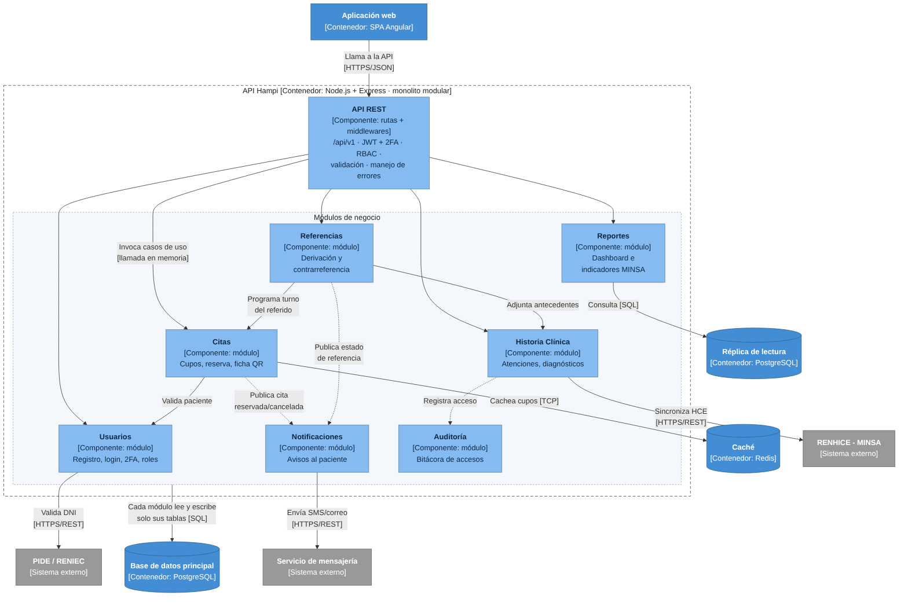

# Nivel 3 · Diagrama de componentes

> **Proyecto:** Hampi Ayacucho · **Contenedor detallado:** API Hampi  
> **Modelo:** C4 · Nivel 3 de 4 · **Versión:** 1.0

---

## 1. Objetivo

Abrir el contenedor **API Hampi** del nivel 2 y mostrar sus **componentes**: los módulos del monolito modular, la responsabilidad de cada uno y cómo se relacionan entre sí y con la base de datos, la caché y los sistemas externos.

| Aspecto | Descripción |
| :--- | :--- |
| Pregunta que responde | ¿Cómo se divide el backend por dentro y qué hace cada parte? |
| Audiencia | Arquitectos y desarrolladores |
| Qué es un componente | Un grupo de funcionalidades con una responsabilidad clara, accesible mediante una interfaz. En este proyecto, cada **módulo** del monolito es un componente |
| Nivel anterior | `Nivel2-DiagramadeContenedores.md` |
| Siguiente nivel | `Nivel4-DiagramadeCodigo.md` |

---

## 2. Diagrama

> Fuente editable: `img/fuentes/nivel3-componentes.mmd`

---

## 3. Componentes

| Componente | Responsabilidad | Funcionalidades principales | Carpeta en el código | Origen |
| :--- | :--- | :--- | :--- | :--- |
| **API REST** | Punto de entrada HTTP del contenedor | Rutas `/api/v1`, JWT + 2FA, RBAC, validación, manejo de errores | `src/shared/http/` | RC03, DA02, DA03 |
| **Usuarios** | Identidad y acceso | Registro, inicio de sesión, 2FA, roles, validación de DNI | `src/modules/usuarios/` | HU02, HU08 · RF02, RF09 |
| **Citas** | Atención ambulatoria | Cupos, reserva, cancelación, ficha QR | `src/modules/citas/` | HU01, HU02 · RF01–RF03 |
| **Historia Clínica** | Información clínica del paciente | Atenciones, diagnósticos, tratamientos, sincronización RENHICE | `src/modules/hce/` | HU03 · RF04 |
| **Referencias** | Derivación entre niveles de atención | Emitir referencia, admitir referido, contrarreferencia | `src/modules/referencias/` | HU04, HU05 · RF05, RF06 |
| **Reportes** | Información para la GERESA | Dashboard de ocupación y colas, indicadores MINSA | `src/modules/reportes/` | HU06, HU07 · RF07, RF08 |
| **Notificaciones** | Comunicación con el paciente | SMS y correos por cambios de estado | `src/modules/notificaciones/` | HU02 · RF03 |
| **Auditoría** | Trazabilidad de datos sensibles | Bitácora de accesos a la HCE | `src/modules/auditoria/` | HU08 · RF09 · RC06 |

---

## 4. Relaciones entre componentes

| Origen | Destino | Descripción | Tipo de comunicación |
| :--- | :--- | :--- | :--- |
| Aplicación web | API REST | Llama a la API | HTTPS/JSON |
| API REST | Módulos de negocio | Invoca los casos de uso | Llamada en memoria |
| Citas | Usuarios | Valida al paciente | Llamada en memoria (API pública del módulo) |
| Referencias | Historia Clínica | Adjunta antecedentes | Llamada en memoria |
| Referencias | Citas | Programa el turno del referido | Llamada en memoria |
| Citas | Notificaciones | Publica cita reservada o cancelada | Evento en memoria |
| Referencias | Notificaciones | Publica el estado de la referencia | Evento en memoria |
| Historia Clínica | Auditoría | Registra cada acceso | Evento en memoria |

---

## 5. Relaciones con contenedores y sistemas externos

| Componente | Destino | Descripción | Protocolo | Patrón aplicado |
| :--- | :--- | :--- | :--- | :--- |
| Todos los módulos | Base de datos principal | Cada módulo lee y escribe **solo sus propias tablas** | SQL | Repository |
| Reportes | Réplica de lectura | Consultas de indicadores | SQL | Repository |
| Citas | Caché (Redis) | Guarda y lee cupos en memoria | TCP | Decorator |
| Usuarios | PIDE / RENIEC | Valida el DNI | HTTPS/REST | Adapter |
| Historia Clínica | RENHICE - MINSA | Sincroniza HCE | HTTPS/REST | Adapter |
| Notificaciones | Servicio de mensajería | Envía SMS y correos | HTTPS/REST | Adapter |

---

## 6. Reglas del monolito modular

| # | Regla | Motivo |
| :--- | :--- | :--- |
| 1 | Todos los componentes se despliegan juntos en el contenedor API Hampi | Es un monolito: un solo proceso y un solo despliegue |
| 2 | Un módulo usa a otro solo a través de su API pública (`index.ts`) | Evita que un cambio interno rompa a los demás |
| 3 | Un módulo no lee ni escribe las tablas de otro módulo | Mantiene la independencia de los datos |
| 4 | Cada sistema externo se integra en un único módulo | La integración queda en un solo lugar y es fácil de reemplazar |
| 5 | Cada módulo se organiza por dentro con Clean Architecture | Las reglas sanitarias no dependen de la tecnología (ver nivel 4) |
