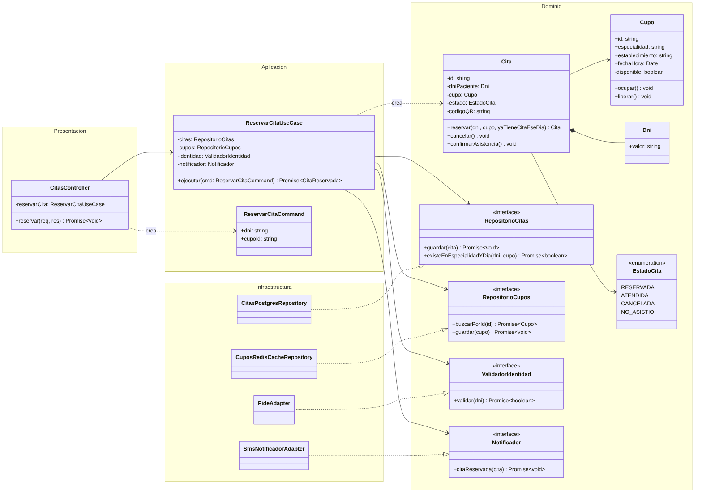
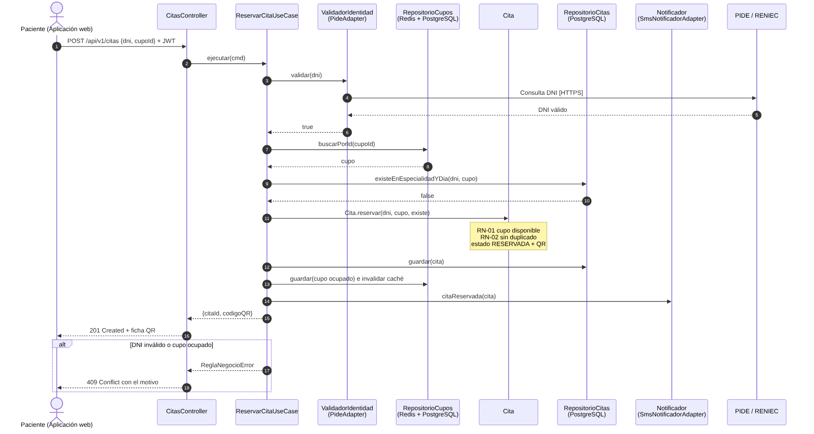

# Nivel 4 · Diagrama de código

> **Proyecto:** Hampi Ayacucho · **Módulo detallado:** Citas  
> **Modelo:** C4 · Nivel 4 de 4 · **Notación:** UML · **Versión:** 1.0

---

## 1. Objetivo

Mostrar **cómo está organizado el código** de un componente del nivel 3: sus clases, interfaces y cómo colaboran. Se detalla el flujo **Reservar cita** (HU02 · RF02, RF03), que involucra la validación del DNI con la PIDE, la caché de cupos y las notificaciones.

| Aspecto | Descripción |
| :--- | :--- |
| Pregunta que responde | ¿Qué clases existen dentro de un módulo y cómo se relacionan? |
| Audiencia | Desarrolladores |
| Notación | UML (diagrama de clases y de secuencia). El modelo C4 recomienda UML para este nivel |
| Por qué solo el módulo Citas | El nivel 4 es opcional y se dibuja solo para los componentes más importantes. Citas concentra la mayor carga (EQ-01) y tres integraciones (BD, caché, PIDE) |
| Nivel anterior | `Nivel3-Diagrama-de-Componentes.md` |

---

## 2. Diagrama de clases

> Fuente editable: `img/fuentes/nivel4-clases.mmd`

### 2.1 Capas de Clean Architecture

| Capa | Contiene | Regla |
| :--- | :--- | :--- |
| **Presentación** | Controladores | Traduce HTTP a llamadas del caso de uso y viceversa |
| **Aplicación** | Casos de uso, comandos | Coordina los pasos del proceso; no conoce la tecnología |
| **Dominio** | Entidades, objetos de valor, interfaces | Contiene las reglas del negocio; no importa nada de otras capas |
| **Infraestructura** | Repositorios y adaptadores | Implementa las interfaces del dominio con una tecnología concreta |

> **Regla de dependencia:** las flechas del código apuntan hacia el dominio. La infraestructura implementa interfaces del dominio (triángulo hueco); el dominio nunca conoce a la infraestructura.

### 2.2 Clases del módulo Citas

| Clase | Tipo | Capa | Responsabilidad |
| :--- | :--- | :--- | :--- |
| `CitasController` | Controlador | Presentación | Recibe `POST /api/v1/citas` y responde al paciente |
| `ReservarCitaCommand` | DTO de entrada | Aplicación | DNI y cupo solicitados |
| `ReservarCitaUseCase` | Caso de uso | Aplicación | Valida identidad, reserva, guarda y notifica |
| `Cita` | Entidad | Dominio | Aplica las reglas de reserva, cancelación y asistencia |
| `Cupo` | Entidad | Dominio | Horario de una especialidad en un establecimiento; se ocupa o libera |
| `Dni` | Objeto de valor | Dominio | Garantiza un DNI de 8 dígitos |
| `EstadoCita` | Enumeración | Dominio | RESERVADA, ATENDIDA, CANCELADA, NO_ASISTIO |
| `RepositorioCitas` | Interfaz | Dominio | Contrato para guardar citas y detectar duplicados |
| `RepositorioCupos` | Interfaz | Dominio | Contrato para buscar y actualizar cupos |
| `ValidadorIdentidad` | Interfaz | Dominio | Contrato para validar un DNI |
| `Notificador` | Interfaz | Dominio | Contrato para avisar al paciente |
| `CitasPostgresRepository` | Repositorio | Infraestructura | Implementa `RepositorioCitas` con PostgreSQL |
| `CuposRedisCacheRepository` | Repositorio (Decorator) | Infraestructura | Implementa `RepositorioCupos` leyendo primero de Redis |
| `PideAdapter` | Adaptador | Infraestructura | Implementa `ValidadorIdentidad` con el servicio de RENIEC vía PIDE |
| `SmsNotificadorAdapter` | Adaptador | Infraestructura | Implementa `Notificador` con el proveedor de SMS |

### 2.3 Notación UML utilizada

| Símbolo | Significado | Ejemplo |
| :--- | :--- | :--- |
| Línea continua con flecha abierta | Asociación: la clase tiene una referencia a la otra | `ReservarCitaUseCase` → `RepositorioCitas` |
| Línea discontinua con flecha abierta | Dependencia: la usa o la crea | `ReservarCitaUseCase` «crea» `Cita` |
| Línea discontinua con triángulo hueco | Realización: implementa una interfaz | `PideAdapter` ▷ `ValidadorIdentidad` |
| Rombo relleno | Composición: la parte no existe sin el todo | `Cita` ◆ `Dni` |
| «interface» | Interfaz | `Notificador` |
| `-` y `+` | Atributo o método privado y público | `- estado`, `+ cancelar()` |
| Subrayado | Método estático | `Cita.reservar()` |

---

## 3. Diagrama de secuencia: reservar cita

> Fuente editable: `img/fuentes/nivel4-secuencia.mmd`

| Paso | Origen → destino | Acción |
| :--- | :--- | :--- |
| 1 | Aplicación web → `CitasController` | Envía `POST /api/v1/citas` con DNI, cupo y el JWT |
| 2 | `CitasController` → `ReservarCitaUseCase` | Ejecuta el caso de uso |
| 3–6 | `ReservarCitaUseCase` → `ValidadorIdentidad` → PIDE | Valida el DNI con RENIEC |
| 7–8 | `ReservarCitaUseCase` → `RepositorioCupos` | Obtiene el cupo (primero desde Redis) |
| 9–10 | `ReservarCitaUseCase` → `RepositorioCitas` | Verifica que no exista otra cita del paciente en la misma especialidad y día |
| 11 | `ReservarCitaUseCase` → `Cita` | Crea la cita: valida RN-01 y RN-02, estado RESERVADA y genera el código QR |
| 12–13 | `ReservarCitaUseCase` → repositorios | Guarda la cita, marca el cupo como ocupado e invalida la caché |
| 14 | `ReservarCitaUseCase` → `Notificador` | Envía la confirmación por SMS |
| 15–16 | `CitasController` → Aplicación web | Responde `201 Created` con la ficha QR |
| 17–18 | Alternativa | Si el DNI es inválido o el cupo está ocupado, responde `409 Conflict` con el motivo de la regla incumplida (y `400` si faltan datos) |

---

## 4. Patrones y principios que se ven en este nivel

| Elemento del diagrama | Patrón o principio |
| :--- | :--- |
| `PideAdapter`, `SmsNotificadorAdapter` | Patrón **Adapter** |
| `RepositorioCitas` y `CitasPostgresRepository` | Patrón **Repository** |
| `CuposRedisCacheRepository` envuelve al repositorio de PostgreSQL | Patrón **Decorator** |
| El caso de uso recibe interfaces, no clases concretas | **Inversión de dependencias** (SOLID) |
| Una clase por responsabilidad (controlador, caso de uso, entidad, repositorio) | **Responsabilidad única** (SOLID) |
| Citas usa a Usuarios solo mediante su `index.ts` | Regla del **monolito modular** |

> Detalle completo en `docs/03-diseño-de-software/diseño-interno/patrones-de-diseño.md` y `principios-de-diseño.md`. El código ejecutable está en `tecnologia/boilerplate-clean-arquitecture/`.
