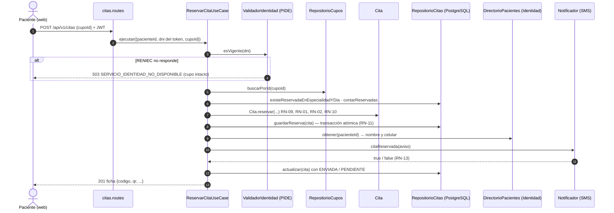

# Plan técnico · Spec 005 · Reserva de cita y ficha QR

> **Sprint:** 2 (backend) · **Spec:** [spec.md](spec.md) · **Código:** `tecnologia/api/src/modules/citas/`

## 1. Decisiones

| Tema | Decisión | Motivo |
| :--- | :--- | :--- |
| Atomicidad (RN-11) | `UPDATE cupos SET estado = 'OCUPADO' WHERE id = $1 AND estado = 'DISPONIBLE'` + `INSERT` de la cita en una transacción | PostgreSQL bloquea la fila: de N reservas simultáneas solo una afecta 1 fila; las demás reciben `CUPO_NO_DISPONIBLE` |
| Duplicado (RN-02) | La regla se valida en el dominio y además con el índice único parcial `citas_un_dia_por_especialidad` | Cubre dos pestañas del mismo paciente reservando a la vez |
| DNI | Se toma del token; el cuerpo solo lleva `cupoId` | Cambio documentado en la spec, §1 |
| Datos del paciente | Puerto `DirectorioPacientes`, implementado en `app.ts` con `identidad.consultarPerfil` | P3: Citas no lee la tabla `usuarios` |
| SMS (RN-13) | `ClienteSms.enviar` nunca lanza; la cita guarda `notificacion = ENVIADA / PENDIENTE` | Una caída del proveedor no deshace la reserva |
| QR (RN-12) | `qrcode` genera un PNG (data URL) con **solo** el código `HAMPI-XXXXXXXX` | Sin datos personales en el QR |

## 2. Flujo implementado

## 3. Sprint 3 · PDF, cancelación y pantallas

| Tema | Decisión |
| :--- | :--- |
| Ficha en PDF (RF03) | Puerto `ExportadorFicha` y adaptador `PdfFichaAdapter` con `pdfkit`: hoja A5 con el QR, los datos de la cita y el recordatorio. La web la pide con el token y la entrega como descarga (`ficha-HAMPI-XXXXXXXX.pdf`) |
| Cancelar (RN-03, RN-15) | `Cita.cancelar(ahora)` exige estado `RESERVADA` y un margen de 2 horas (`FUERA_DE_PLAZO`, 409); libera el cupo en la misma transacción que actualiza la cita |
| Pantallas | Reserva en cuatro pasos (especialidad → establecimiento → día y hora → confirmar). Si otra persona gana el cupo, la web vuelve al paso de la hora mostrando el motivo y con los cupos ya recargados (RN-01) |

**Sigue pendiente:** reintentar las notificaciones que quedaron en `PENDIENTE` (RN-13).

El estado `NO_ASISTIO` y `confirmarAsistencia` ya existen en el dominio, pero no se exponen todavía:
son del módulo de atención, fuera del alcance actual.

## 4. Verificación

| Criterios | Prueba |
| :--- | :--- |
| CA-005-1 … CA-005-11 | `src/pruebas/api/citas.test.ts` (bloque "Spec 005") |
| CA-005-5 y RN-02 con PostgreSQL real (10 reservas simultáneas) | `src/pruebas/integracion/postgres.test.ts` |
| RN-01 … RN-04, RN-09, RN-10, RN-15, texto del SMS | `src/pruebas/unitarias/dominio.test.ts` |
| CA-005-12 (cancelar) y la ficha en PDF | `src/pruebas/api/citas.test.ts` (bloque "Spec 005") |
| Camino completo en el navegador (reserva, QR, PDF, cancelación) | `tecnologia/web/e2e/reserva.spec.ts` |
